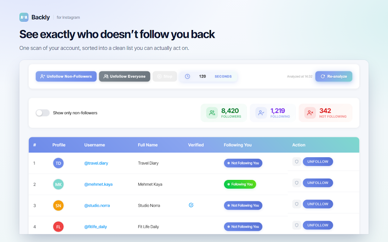
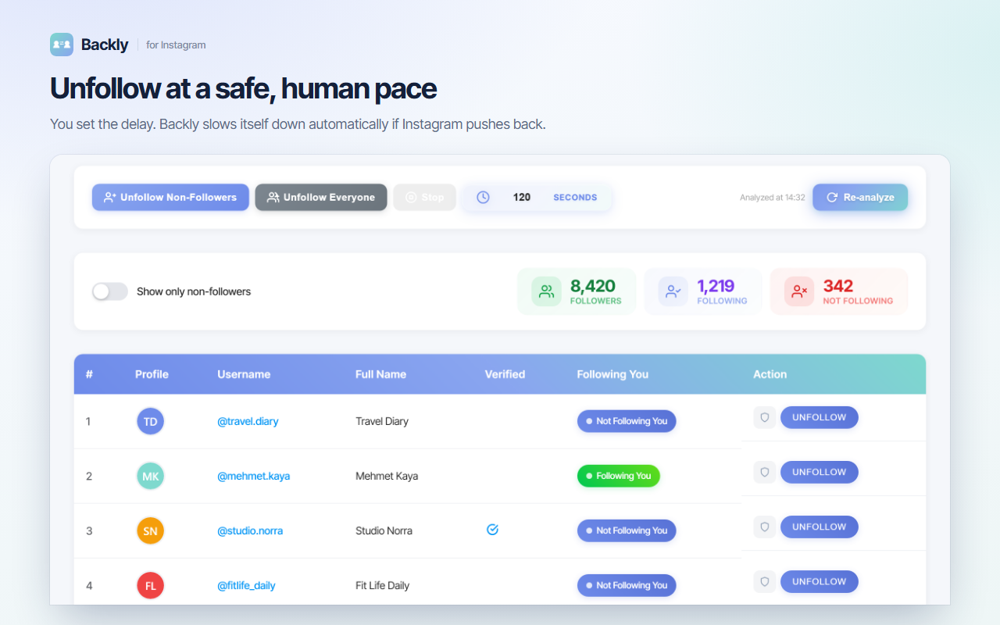
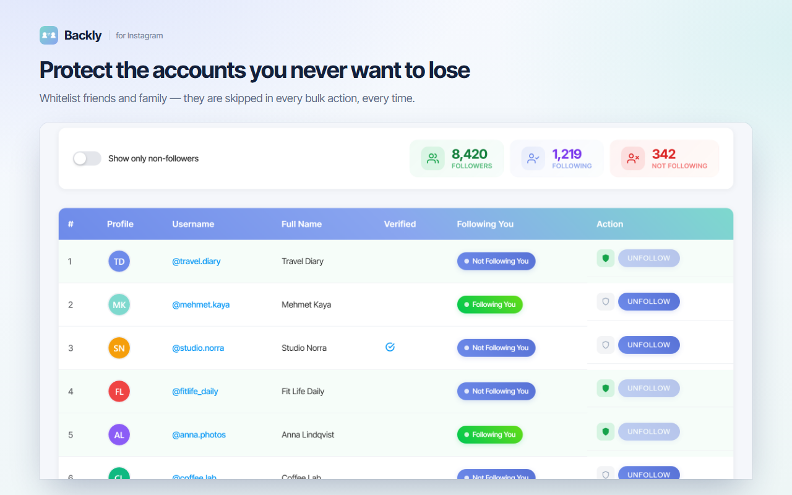

# Backly: Unfollower Tracker and Paced Mass Unfollow for Instagram

Backly is a Chrome extension for cleaning up the list of accounts you follow on Instagram. It shows who does not follow you back, lets you unfollow only those accounts or start over by unfollowing everyone, and does it at a slow, human pace with a delay you choose.

**[Install from the Chrome Web Store](https://chromewebstore.google.com/detail/hcfjllbbehamkmgmoicbpionaopcodde?utm_source=github&utm_medium=readme&utm_campaign=backly)** | **[Full guide and FAQ](https://www.addonschrome.com/extensions/instagram-unfollowers-who-doesn-t-follow-me-back.html?utm_source=github&utm_medium=readme&utm_campaign=backly)** | **[Video demo](https://www.youtube.com/watch?v=r1QV_1GGK6o)**

This repository is the public home for Backly documentation, release notes and the issue tracker. The extension itself is distributed through the Chrome Web Store.

## Features

- A clear list of the accounts that do not follow you back
- Two modes: unfollow only non-followers, or unfollow everyone
- Adjustable delay between unfollows, from 3 to 300 seconds
- Shield list: protected accounts are never unfollowed
- See what changed since your last scan
- Filter the list down to non-followers only

## How to use it

1. Install Backly from the [Chrome Web Store](https://chromewebstore.google.com/detail/hcfjllbbehamkmgmoicbpionaopcodde?utm_source=github&utm_medium=readme&utm_campaign=backly) and sign in with Google.
2. Open Instagram in Chrome on your computer while logged in.
3. Run a scan to load the accounts you follow.
4. Add the accounts you want to keep to the shield list.
5. Choose the mode, set the delay and start. You can stop at any time.

The [full guide](https://www.addonschrome.com/extensions/instagram-unfollowers-who-doesn-t-follow-me-back.html?utm_source=github&utm_medium=readme&utm_campaign=backly) explains each setting.

## Avoiding action blocks

Instagram temporarily blocks accounts that unfollow too many people too quickly. The delay setting exists for that reason: keep it long, work in small daily batches, and stop for the day if Instagram shows a warning. Cleaning a large list properly takes days, not minutes.

## Pricing

Backly is free to start. Current limits and plans are on the [extension page](https://www.addonschrome.com/extensions/instagram-unfollowers-who-doesn-t-follow-me-back.html?utm_source=github&utm_medium=readme&utm_campaign=backly).

## Screenshots

## Support and feedback

Found a bug or want a feature? [Open an issue](../../issues) in this repository. Please include your Chrome version and the steps that led to the problem.

## Disclaimer

Backly is an independent tool. It is not affiliated with, endorsed by or sponsored by Instagram or Meta Platforms, Inc. Instagram is a trademark of Meta Platforms, Inc. and is used here only to describe what the tool works with. You are responsible for using it within the platform's rules.

---

Built and maintained by [Addons Chrome](https://www.addonschrome.com/?utm_source=github&utm_medium=readme&utm_campaign=backly).
